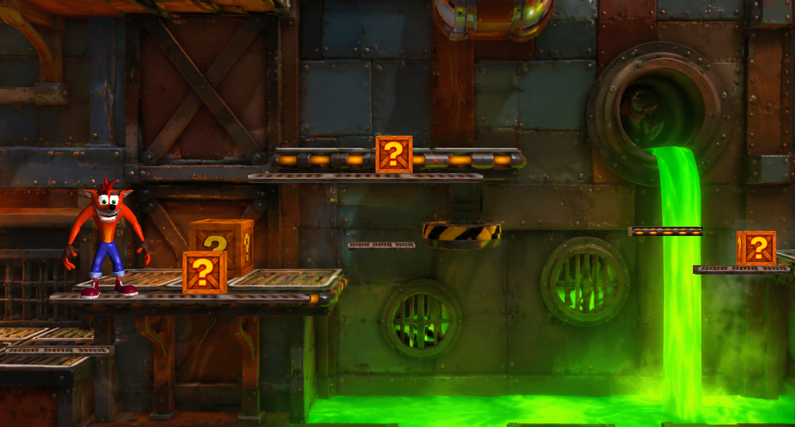
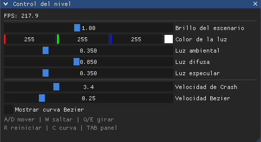

# CrashBandicoot-ComputacionGrafica
Proyecto final de Computación Gráfica en C++ y OpenGL.

# Crash Bandicoot - Proyecto final

**Estudiante:** Jaiderk David Corredor Mateus  
**Código:** 6000726  
**Asignatura:** Computación Gráfica

## Descripción

Nivel lateral inspirado en Crash Bandicoot, desarrollado en C++ con OpenGL. El personaje se mueve por plataformas, salta sobre cajas y reaparece al caer en el líquido tóxico. También incluye una plataforma móvil que sigue una curva Bézier y un panel para modificar parámetros en tiempo real.

## Herramientas

- C++ y OpenGL 3.3
- GLFW y GLAD
- Dear ImGui
- Visual Studio
- Modelo OBJ con materiales y texturas

## Funciones principales

- Movimiento lateral con salto, gravedad y colisiones.
- Plataformas estáticas, cajas sólidas y plataforma móvil.
- Curva Bézier cúbica para el recorrido de la plataforma móvil.
- Matrices de traslación, rotación, vista y proyección.
- Iluminación Phong (ambiental, difusa y especular).
- Panel Dear ImGui para cambiar brillo, color de luz, velocidad de Crash y velocidad Bézier, además de mostrar FPS.

## Controles

| Tecla | Acción |
|---|---|
| A / D | Mover |
| W | Saltar |
| Q / E | Girar |
| C | Mostrar u ocultar la curva Bézier |
| R | Reiniciar |
| TAB | Abrir o cerrar el panel |
| ESC | Salir |

## Arquitectura

- `main.cpp`: escena, shaders, matrices, movimiento, colisiones, Bézier y panel.
- `ObjLoader.h`: carga del modelo OBJ, materiales y texturas.
- `Crash/`: modelo y texturas del personaje.
- `Fondo/` y `Texturas/`: imágenes del escenario, cajas y plataformas.
- `Libraries/` e `imgui/`: bibliotecas del proyecto.

## Capturas

### Nivel

### Panel de control

## Ejecución

Abrir `CrashBandicoot.slnx` en Visual Studio, seleccionar **x64** y ejecutar con **F5**. El proyecto no utiliza CMake.

## Video explicativo
https://www.youtube.com/watch?v=b99khq3BGhg
